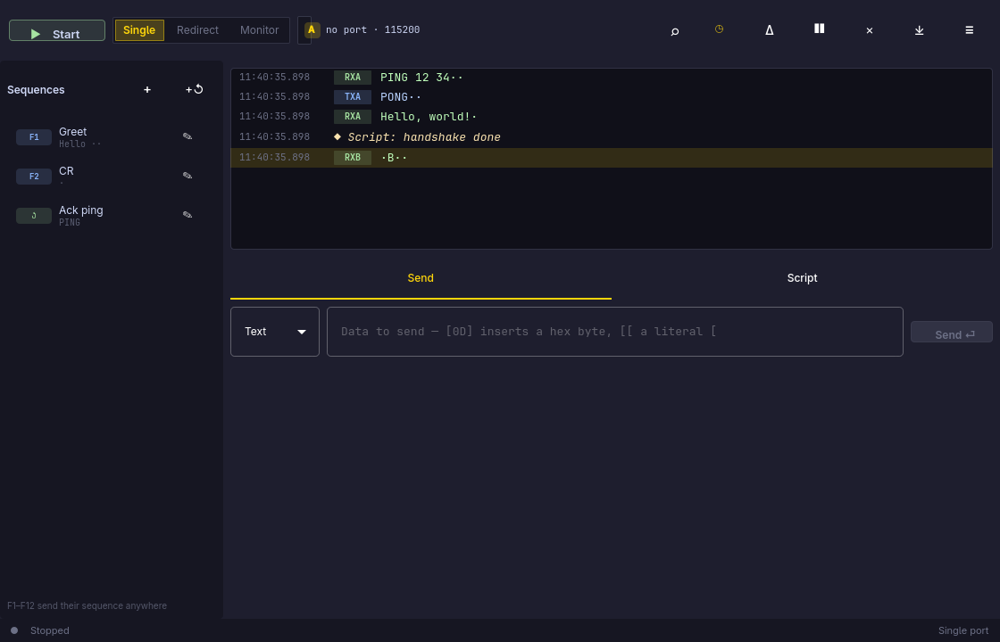

# Lucidlight

<p align="center"></p>

A serial monitor, terminal, and test scripting tool for Arch Linux — built in
the spirit of [Docklight Scripting](https://www.docklight.de/): watch the bytes
flow, poke the device, automate the whole conversation with a script.

## Features

- **Serial terminal** — open any `/dev/ttyUSB*`, `/dev/ttyACM*`, `/dev/ttyS*`,
  `/dev/ttyAMA*` (or a by-id path) at 300…4000000 baud, 5–8 data bits,
  none/even/odd/mark/space parity, 1–2 stop bits, no/RTS-CTS/Xon-Xoff flow.
  Implemented directly on POSIX termios, so it only needs Qt. **Network
  channels** work the same way: `TCP:host:port` (client), `SERVER:port`
  (accepts one connection), `UDP:host:port`, `UDP:port`, plus local Unix
  domain sockets `UNIX:/path` (client) and `UNIXSERVER:/path` (listener) —
  type them into
  the device field.
- **Three communication modes**, like Docklight:
  - *Single* — one port, send and receive.
  - *Redirect* — transmit on port A, receive the reply on port B.
  - *Monitor* — two read-only taps between two devices, color-coded by side.
- **Communication window** — every burst timestamped, tagged RX/TX (+A/B in
  monitor mode), shown as ASCII, HEX, DEC, or **Binary** (Ctrl+Tab cycles).
  Contents filter (all / channel 1 / channel 2 / comments), optional
  control-character names (`<CR><LF>`), pause-detection stamps. Freeze the
  view while data keeps flowing, search with glowing matches, copy any line
  as text or hex, save the whole log, and the **Snapshot** camera button:
  hide the window while it waits for a trigger sequence, then reveal the
  buffered data with the trigger mid-window and stop.
- **Send / receive sequences** — named snippets in Text/Hex/Dec/Binary
  notation with wildcard parameters, function characters (`&` delay, `%`
  break, `!` handshake), **checksum areas** (MOD256, XOR, LRC, CRC-8/16/32,
  MODBUS, CCITT… or a generic CRC spec), bound to **Ctrl+F1–F12** so they fire
  anywhere, optional auto-repeat, and **receive triggers**: a receive
  pattern (with `?`/`#` wildcards and checksum validation) that answers,
  comments with `%_` macros, snapshots, or stops the run.
- **Scripting** — JavaScript with a `DL` object that mirrors Docklight's
  VBScript API: `SendSequence`, `WaitForSequence`, `DirectSend`,
  `CalcChecksum`, `ConvertSequenceData`, channel settings, handshake
  signals, `OnSend_`/`OnReceive_` event procedures, `MsgBox2`/`InputBox2`,
  file logging (`_asc/_hex/_dec/_bin` as txt/htm/rtf), FileInput/FileOutput,
  side channels 3–10, and more. Blocking `DL.Receive*` calls park the
  script, never the UI; a runaway script is always stoppable. Editor with
  highlighting, line numbers, and an output pane. Scripts can auto-run when
  a project opens.
- **Agent-friendly** — the same engine runs headless with NDJSON output,
  exit codes, and test verdicts (`DL.Assert`/`DL.Fail`), and a bundled agent
  skill: `lucidlight skill install`.
- **Projects** — one `.llproj` JSON file keeps mode, both port configs, all
  sequences, the script, and display options. The session autosaves to
  `~/.local/state/lucidlight/`.
- **Headless runs** — drive the same engine from the shell for CI and agents:
  `lucidlight run project.llproj --script test.js`.

## Install

```sh
cd lucidlight
./install.sh        # builds and installs via makepkg, shows up in the launcher
```

Or manually: `./build.sh` and copy `build/lucidlight` somewhere on `$PATH`.
Serial devices need your user in the `uucp` group (Omarchy sets this up).

## Data notation

Used everywhere: the send bar, sequences, and `DL.Send`.

| Input | Meaning |
|---|---|
| `Hello` | literal characters (UTF-8) |
| `[0D]` | one hex byte (`1` or `2` digits) |
| `[[` | a literal `[` |
| `48 65 6C` | in Hex mode: byte pairs, `??` = one unknown byte |
| `72 101 108` | in Dec mode: decimal bytes, `??` = one unknown byte |
| `??` | receive patterns only: matches one arbitrary byte |

## Shortcuts

| Key | Action |
|---|---|
| `Space` | Start / stop communication |
| `Enter` | Send the typed data |
| `F1`–`F12` | Send the sequence bound to that key |
| `Ctrl+R` | Run the script |
| `Ctrl+K` | Clear the window |
| `Ctrl+F` | Search in the data |
| `Ctrl+B` | Toggle the sequence panel |
| `Ctrl+O` / `Ctrl+S` | Open / save the project |
| `Ctrl+Shift+S` | Save the communication log |
| `?` | Help overlay |
| `Ctrl+Q` | Quit |

## Scripting — the `DL` object

Scripts are JavaScript, executed in a worker thread so the window stays alive.
`print(...)` writes to the output pane. Blocking calls check for Stop
continuously, and `DL.Break()` ends the script early.

```js
// Ask for the firmware version and check the answer
DL.StartCommunication();
DL.Send("ATI\r");
if (DL.ReceiveStr("OK", 1000)) {
    var reply = DL.Receive(16, 500);          // exactly 16 bytes, or false
    DL.Comment("Reply: " + DL.HexToStr(reply));
} else {
    DL.ShowMessage("No answer from the device");
}
DL.StopCommunication();
```

### Communication
| Call | Meaning |
|---|---|
| `DL.StartCommunication()` / `DL.StopCommunication()` | open the ports configured in the UI / close them |
| `DL.IsCommRunning()` | is the link up? |
| `DL.SetCommMode(mode)` | 0 single, 1 redirect, 2 monitor (while stopped) |
| `DL.ClearComm()` | wipe the communication window |

### Sending
| Call | Meaning |
|---|---|
| `DL.Send(data)` | project notation (Text mode: `[0D]` etc.) |
| `DL.SendHex("48 65")` / `DL.SendStr(text)` | raw hex / UTF-8 text |
| `DL.SendBytes([1, 2, 3])` | JS array of 0–255 |
| `DL.SendSequence("Name")` | send a sequence by name (or index) |
| `DL.SendBreak(ms)` / `DL.SetDTR(b)` / `DL.SetRTS(b)` | line control |
| `DL.GetCTS()` / `DL.GetDSR()` / `DL.GetDCD()` / `DL.GetRI()` | read modem lines |

### Receiving (blocks the script, never the UI)
| Call | Meaning |
|---|---|
| `DL.Receive(count, timeoutMs)` | next `count` bytes as a string, or `false` on timeout |
| `DL.ReceiveLine(timeoutMs)` | next line without its CR/LF, or `false` |
| `DL.ReceiveStr(text, timeoutMs)` | `true` when `text` appears; the stream is consumed up to it |
| `DL.ReceiveHex("AA ?? 55", timeoutMs)` | hex of the matched bytes (wildcards allowed), or `false` |

### Timing, output, helpers
| Call | Meaning |
|---|---|
| `DL.Wait(ms)` / `DL.Pause()` | delay / process pending events |
| `DL.StartTime()` / `DL.TimeDiff()` | milliseconds since start / seconds as a float |
| `DL.Comment(text)` | write a note into the communication window |
| `DL.ShowMessage(text)` | toast for the user |
| `DL.Break()` | stop the script |
| `DL.Fail(message)` | stop and fail the run (headless exit code 1) |
| `DL.Assert(condition, message)` | `Fail` when the condition is false |
| `DL.WaitForSequence(name, timeoutMs)` | wait for a named receive sequence to match |
| `DL.Env(name, fallback)` | read an environment variable |
| `DL.SaveLog(path)` | dump the communication window so far to a file |
| `DL.HexToStr(h)` / `DL.StrToHex(s)` | byte↔string (1:1, Latin-1) |
| `DL.HexToDec(h)` / `DL.DecToHex(d, digits)` | number conversions |
| `DL.Asc(ch)` / `DL.Chr(n)` | character code helpers |

## Headless mode

```sh
# Run a project's conversation for 10 seconds and print the traffic:
lucidlight run device.llproj --port-a /dev/ttyUSB0

# Full scripted test; exits 1 when the script fails:
lucidlight run device.llproj --script smoke.js --duration 60 --baud 9600

# Machine-readable run for CI and agents (NDJSON, ends with a result line):
lucidlight run device.llproj --script smoke.js --json --out capture.log

# Teach your coding agent the whole workflow:
lucidlight skill install
```

Stream semantics: receives consume what they match; anything before or after
the match stays in the buffer. Finish a matched line with
`DL.ReceiveLine(timeout)` before reading the next one.

## Agent skill

`lucidlight skill` prints a compact guide (project schema, DL API, socat
loopback recipe) for coding agents; `lucidlight skill install` installs it
into `~/.pi/agent/skills/lucidlight/`.

## Development

```sh
./build.sh          # qmake6 + make into build/lucidlight
./test.sh           # 100 unit and end-to-end tests (offscreen)
tests/grab_harness   # LUCID_SIM=1 LUCID_TAB=script ./grab_harness — screenshots offscreen
```

## License

MIT — see [LICENSE](LICENSE).
